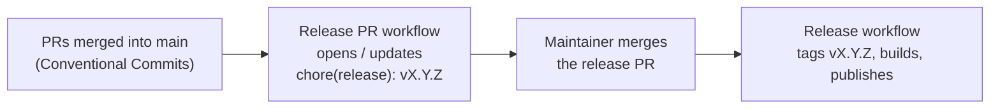

# Releasing 3BCAD

Releases are automated. 3BCAD uses [Semantic Versioning](https://semver.org); the version lives in one place,
`version` under `[workspace.package]` in the root `Cargo.toml`, and the app shows it in its title bar and ribbon.

## How it works

1. **Every commit is a [Conventional Commit](https://www.conventionalcommits.org)**, e.g.
   `feat(sketch): add arc tool`, `fix(io): correct STL header`, `docs: update README`. The `Commits` check
   enforces it on every pull request.
2. **After each push to `main`**, the [Release PR workflow](.github/workflows/release-pr.yml) works out
   whether a release is due and the next version:

   | Since the last release | Bump | Example |
   | --- | --- | --- |
   | `fix:` or `perf:` commits, or `### Fixed` in `[Unreleased]` | patch | 0.2.0 → 0.2.1 |
   | `feat:` commits, or `### Added` / `### Changed` in `[Unreleased]` | minor | 0.2.1 → 0.3.0 |
   | `feat!:` / `BREAKING CHANGE:` commits, or `### Removed` | major (minor before 1.0) | 1.4.0 → 2.0.0 |
   | only `docs`, `ci`, `test`, `chore`, `refactor`, `style`, `build` | no release | |

   If one is due it opens (or updates) a pull request **`chore(release): vX.Y.Z`** that bumps `Cargo.toml` and
   `Cargo.lock` and turns `[Unreleased]` in `CHANGELOG.md` into the `[X.Y.Z]` section. Hand-written
   `[Unreleased]` notes are used as they are; if the section is empty, notes are generated from the commit messages.
3. **Merging the release PR publishes the release.** The [Release workflow](.github/workflows/release.yml)
   sees a `Cargo.toml` version that has no tag yet, then:
   - checks that `CHANGELOG.md` has notes for it,
   - builds Windows (x64 `.zip` and `.msi` installer), macOS (universal `3BCAD.app` in a `.zip` and in a `.dmg`)
     and Linux (x64 `.tar.gz` and `.AppImage`), signed when the [signing secrets](#code-signing) exist,
   - creates the `vX.Y.Z` tag and GitHub Release with those files, `SHA256SUMS.txt` and the changelog notes.

The builds live in [package.yml](.github/workflows/package.yml). It also runs, unsigned and unpublished, on pull
requests that change `packaging/`, `assets/`, the app's `build.rs` or the release workflows, so the installers are
tested before release day: WiX ICE validation, `plutil -lint`, `hdiutil verify`, `desktop-file-validate`, unpacking
the AppImage, and a check that `3bcad.exe` carries the version details `build.rs` embeds with its icon.

The one manual step is merging the release PR: `main` requires a code-owner review, which a bot cannot give.
Edit the release PR's CHANGELOG section before merging if you want to polish the notes.

## Writing good release notes

Add user-facing changes to `## [Unreleased]` in `CHANGELOG.md` as part of each feature PR (under `### Added`,
`### Changed`, `### Fixed`, `### Removed`). Commit messages are only the fallback.

## One-time setup

- **Repository setting**: Settings → Actions → General → "Allow GitHub Actions to create and approve pull
  requests" must be on, so the workflow can open the release PR.
- **Optional `RELEASE_TOKEN` secret**: pull requests opened with the default `GITHUB_TOKEN` do not trigger CI, so
  the required checks never run on the release PR and it can only be merged with the admin bypass. Add a
  fine-grained personal access token (or GitHub App token) with *Contents: read & write* and *Pull requests:
  read & write* on this repository as the `RELEASE_TOKEN` Actions secret to get normal CI on release PRs.

## Code signing

Signing runs only when its secrets exist (Settings → Secrets and variables → Actions), and never for pull requests.
Without them releases are built as before: Windows unsigned, macOS with an ad-hoc signature. Windows is set up to
sign through the [SignPath Foundation](#setting-up-signpath-free-windows-signing-for-open-source) (free for open
source); a certificate file still works as before when SignPath is not configured.

| Secret | What it is |
| --- | --- |
| `SIGNPATH_API_TOKEN` | API token of a SignPath user with *Submitter* rights on the project (Windows signing through SignPath) |
| `WINDOWS_CERTIFICATE` | Authenticode code-signing certificate with its private key, as a base64 `.pfx` (`base64 -w0 cert.pfx`) |
| `WINDOWS_CERTIFICATE_PASSWORD` | the `.pfx` password |
| `MACOS_CERTIFICATE` | "Developer ID Application" certificate with its private key, exported from Keychain Access as a `.p12`, base64 |
| `MACOS_CERTIFICATE_PASSWORD` | the `.p12` password |
| `APPLE_ID` | the Apple ID of the Apple Developer Program account, for notarization |
| `APPLE_TEAM_ID` | that account's 10-character team ID |
| `APPLE_APP_PASSWORD` | an app-specific password for that Apple ID (account.apple.com → Sign-In and Security) |

- **Windows, SignPath** (used when `SIGNPATH_API_TOKEN` exists; set up below): `package.yml` builds `3bcad.exe` and
  the `.msi` around it, uploads both as the `signpath-unsigned-windows` artifact (kept 1 day, never published:
  `release.yml` only downloads `3BCAD-*`) and submits one signing request. SignPath signs the program, the copy
  inside the installer and the installer, as [`packaging/windows/signpath.xml`](packaging/windows/signpath.xml)
  says; the job waits up to 2 hours for the request to be approved, checks both signatures, then packs the `.zip`.
- **Windows, certificate file** (used when only `WINDOWS_CERTIFICATE` exists):
  [`packaging/windows/sign.ps1`](packaging/windows/sign.ps1) signs `3bcad.exe` (before it goes into the `.zip` and
  the `.msi`) and then the `.msi` with signtool (SHA-256, RFC 3161 timestamp), and checks both with
  `signtool verify /pa`. Since June 2023 new public code-signing certificates are issued only on hardware tokens or
  cloud HSMs, so a `.pfx` file may not be available.
- **macOS**: the certificate goes into a throwaway keychain. `3BCAD.app` is signed with the hardened runtime,
  notarized (`notarytool submit --wait`) and stapled, then the `.dmg` around it is signed, notarized and stapled.
  CI checks them with `codesign --verify --deep --strict`, `spctl -a -vv` and `xcrun stapler validate`. The `.zip`
  and the `.dmg` hold the same app.

### Setting up SignPath (free Windows signing for open source)

The certificate is issued to SignPath Foundation, which then shows as the publisher. Its conditions are on
[signpath.org/terms](https://signpath.org/terms); the ones that shape our process:

- an OSI-approved licence with no commercial dual licensing (3BCAD is Apache-2.0 only), a public repository, an
  existing release, and a [code signing policy](README.md#code-signing-policy) on the home page;
- multi-factor authentication for every team member on GitHub and SignPath;
- every signing request is approved by hand, and builds run only on GitHub-hosted runners;
- product name and version are enforced on each signed program (`signpath.xml` does this).

Steps:

1. Apply at [signpath.org/apply](https://signpath.org/apply) and wait for the free subscription to be approved.
2. In SignPath: add the predefined trusted build system **GitHub.com** to the organization; create the project
   (slug `3bcad`) linked to it and to this repository; add the artifact configuration with slug `windows` from
   [`packaging/windows/signpath.xml`](packaging/windows/signpath.xml); create the signing policy (slug
   `release-signing`) with the Foundation certificate and the approvers from the code signing policy.
3. Create a SignPath user (or CI user) with *Submitter* rights on that policy and copy its API token.
4. In GitHub (Settings → Secrets and variables → Actions): the secret `SIGNPATH_API_TOKEN`, and the variable
   `SIGNPATH_ORGANIZATION_ID` (from SignPath). `SIGNPATH_PROJECT_SLUG` and `SIGNPATH_SIGNING_POLICY_SLUG` are only
   needed if the slugs differ from `3bcad` and `release-signing`.
5. Try it without releasing: Actions → **Package** → **Run workflow** on `main`, approve the request in SignPath,
   and check that the job's "Use the signed files" step lists both files as signed.

If `signpath.xml` changes, paste the new version into SignPath before the next release.

## When something goes wrong

- **Release build failed**: fix it on `main` through a normal PR, then re-run the Release workflow from the
  Actions tab (*Run workflow* on `main`). It only releases versions that have no tag yet.
- **Wrong version in the release PR**: edit `Cargo.toml` and `CHANGELOG.md` on the `release/next` branch before
  merging, or add the missing `feat`/`fix` changes to `[Unreleased]` on `main`.
- Never delete or reuse a version tag that users may have downloaded; release a new patch version instead.

## In-app updates

From 0.8.0 on, the app updates itself from these releases (`crates/3bcad-app/src/update.rs`): it reads
`releases/latest` from the GitHub API, picks the asset whose name ends with `-windows-x64.zip`,
`-macos-universal.zip` or `-linux-x64.tar.gz`, checks it against `SHA256SUMS.txt` and swaps it in. Keep those
asset names, the folder inside each archive (`3bcad.exe`, `3BCAD.app`, `3bcad`) and `SHA256SUMS.txt`, or older
copies of the app can no longer update. Pre-releases are not offered (`releases/latest` skips them).

The installers' names (`-windows-x64.msi`, `-macos-universal.dmg`, `-linux-x86_64.AppImage`) never match those
endings. From 1.0 on the file names carry no version (`3BCAD-windows-x64.msi`), so the links in README.md and
`docs/guide/installing.md` (`releases/latest/download/<name>`) always fetch the newest release: keep the names
fixed. The `.msi` installs per user into `%LOCALAPPDATA%\Programs\3BCAD`, without admin rights, so the updater can
replace `3bcad.exe` there.

## Known limitations

- Until [SignPath](#setting-up-signpath-free-windows-signing-for-open-source) or the other signing secrets are set
  up, the builds are not code-signed. On first launch Windows
  SmartScreen shows "Windows protected your PC" (click **More info → Run anyway**), and macOS needs a right-click on
  `3BCAD.app` → **Open**. Even when signed, SmartScreen can warn until a new certificate has built up reputation.
- On macOS, double-clicking a 3BCAD file in Finder does not open it (Finder sends files as Apple Events, which
  eframe cannot receive): drag files onto the window or use **File → Open**. Windows (`.msi`) and Linux (the
  AppImage, once integrated into the desktop by e.g. AppImageLauncher or Gear Lever) open `.3bcad`, `.3bcasm` and
  `.3bcdrw` files in 3BCAD, and offer it under "Open with" for STEP, STL, 3MF, OBJ and DXF.
- After an in-app update, Windows "Installed apps" still lists the version the `.msi` installed.
- The AppImage runs from a read-only image, so it cannot update itself: download the new AppImage instead.
