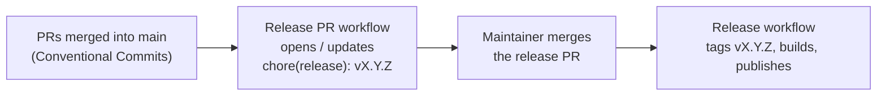

# Releasing 3BCAD

Releases are automated. 3BCAD uses [Semantic Versioning](https://semver.org); the version lives in one place,
`version` under `[workspace.package]` in the root `Cargo.toml`, and the app shows it in its title bar and ribbon.

## How it works

1. **Every commit is a [Conventional Commit](https://www.conventionalcommits.org)**, e.g.
   `feat(sketch): add arc tool`, `fix(io): correct STL header`, `docs: update README`. The `Commits` check
   enforces it on every pull request.
2. **After each push to `main`**, the [Release PR workflow](.github/workflows/release-pr.yml) works out
   whether a release is due and the next version:

   | Since the last release | Bump | Example |
   | --- | --- | --- |
   | `fix:` or `perf:` commits, or `### Fixed` in `[Unreleased]` | patch | 0.2.0 → 0.2.1 |
   | `feat:` commits, or `### Added` / `### Changed` in `[Unreleased]` | minor | 0.2.1 → 0.3.0 |
   | `feat!:` / `BREAKING CHANGE:` commits, or `### Removed` | major (minor before 1.0) | 1.4.0 → 2.0.0 |
   | only `docs`, `ci`, `test`, `chore`, `refactor`, `style`, `build` | no release | |

   If one is due it opens (or updates) a pull request **`chore(release): vX.Y.Z`** that bumps `Cargo.toml` and
   `Cargo.lock` and turns `[Unreleased]` in `CHANGELOG.md` into the `[X.Y.Z]` section. Hand-written
   `[Unreleased]` notes are used as they are; if the section is empty, notes are generated from the commit messages.
3. **Merging the release PR publishes the release.** The [Release workflow](.github/workflows/release.yml)
   sees a `Cargo.toml` version that has no tag yet, then:
   - checks that `CHANGELOG.md` has notes for it,
   - builds Windows (x64 `.zip`), macOS (universal `.app` in a `.zip`) and Linux (x64 `.tar.gz`),
   - creates the `vX.Y.Z` tag and GitHub Release with those files, `SHA256SUMS.txt` and the changelog notes.

The one manual step is merging the release PR: `main` requires a code-owner review, which a bot cannot give.
Edit the release PR's CHANGELOG section before merging if you want to polish the notes.

## Writing good release notes

Add user-facing changes to `## [Unreleased]` in `CHANGELOG.md` as part of each feature PR (under `### Added`,
`### Changed`, `### Fixed`, `### Removed`). Commit messages are only the fallback.

## One-time setup

- **Repository setting**: Settings → Actions → General → "Allow GitHub Actions to create and approve pull
  requests" must be on, so the workflow can open the release PR.
- **Optional `RELEASE_TOKEN` secret**: pull requests opened with the default `GITHUB_TOKEN` do not trigger CI, so
  the required checks never run on the release PR and it can only be merged with the admin bypass. Add a
  fine-grained personal access token (or GitHub App token) with *Contents: read & write* and *Pull requests:
  read & write* on this repository as the `RELEASE_TOKEN` Actions secret to get normal CI on release PRs.

## When something goes wrong

- **Release build failed**: fix it on `main` through a normal PR, then re-run the Release workflow from the
  Actions tab (*Run workflow* on `main`). It only releases versions that have no tag yet.
- **Wrong version in the release PR**: edit `Cargo.toml` and `CHANGELOG.md` on the `release/next` branch before
  merging, or add the missing `feat`/`fix` changes to `[Unreleased]` on `main`.
- Never delete or reuse a version tag that users may have downloaded; release a new patch version instead.

## Known limitations

The builds are not code-signed yet. On first launch Windows SmartScreen shows "Windows protected your PC"
(click **More info → Run anyway**), and macOS needs a right-click on `3BCAD.app` → **Open**.
