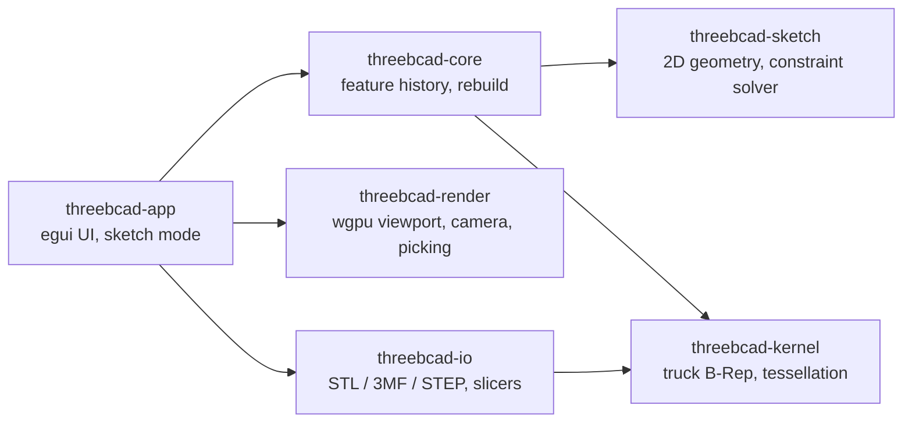
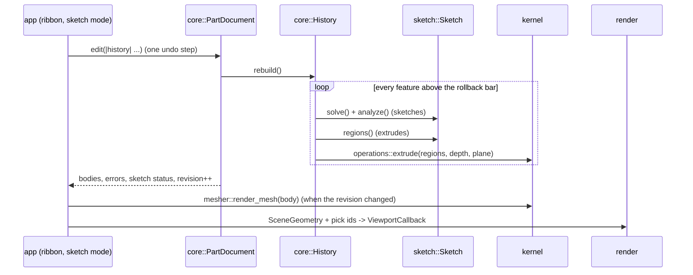

# 3BCAD architecture

3BCAD is a Cargo workspace of six crates. Each one owns one of the systems that make a parametric
CAD program, mirroring the split SolidWorks uses (kernel, 2D solver, feature tree, graphics, print tooling).

Dependency rules: `core` never depends on `render` or `app`; `kernel` never depends on `sketch`
(it takes its own `ProfileRegion` type, and `core` converts sketch regions into it).

## Data flow of a rebuild

1. **Sketch** (`crates/3bcad-sketch`). Points live in one parameter vector. Every relation and
   dimension is a `Constraint` whose residuals are written once over the `Scalar` trait: evaluated
   with `f64` they give values, with the `Dual` number type they give exact derivatives. The solver
   (`solver.rs`) splits the sketch into independent components and runs Levenberg-Marquardt on each,
   using dense Cholesky for small components and preconditioned conjugate gradients for big ones.
   `analyze()` gets degrees of freedom and conflicts from the Jacobian's null space, which drives
   the blue / black / red colours. `regions()` finds closed loops (with holes) for features.
2. **History** (`crates/3bcad-core`). Features sit in a `petgraph` DAG (edge = "is built from") with
   a SolidWorks-style rollback bar. `rebuild()` evaluates everything above the bar and records
   per-feature errors instead of failing the whole part.
3. **Kernel** (`crates/3bcad-kernel`). Profiles become truck wires/faces on the sketch plane, are
   swept along the plane normal, and are tessellated per face so triangles keep their B-Rep face
   index (for picking) and planar faces report their plane (for sketch-on-face).
4. **Render** (`crates/3bcad-render`). The app builds a `SceneGeometry` whose vertices carry a pick
   id. Hover and selection are a per-id state buffer on the GPU, so highlighting never re-uploads
   meshes. `pick()` ray-casts faces/planes and measures edges/vertices in screen space.
5. **App** (`crates/3bcad-app`). `eframe` window; `ui/sketch_mode.rs` holds the interactive sketcher
   (tools, inferencing, Smart Dimension, drag), working on a copy of the sketch that is written back
   as one undo step when you exit the sketch.

## Adding a new feature type (example: Revolve)

1. **Kernel**: add `operations::revolve(regions, axis, angle, plane) -> Result<Vec<Solid>>` with a
   test that checks a physical property (volume of a revolved rectangle = cylinder/tube volume) and
   watertightness (see `mesher.rs` tests).
2. **Core**: add a variant to `FeatureKind` in `feature.rs`, a constructor in `History`
   (`add_revolve`) that validates its inputs and adds the graph edge to the sketch it uses, and a
   match arm in `History::rebuild()`. Add a `document.rs` test that builds and rolls it back.
3. **App**: a ribbon button in `ui/ribbon.rs` (Features tab), its parameters in
   `ui/properties.rs` (edit through `doc.edit_merging` so drags are one undo step), and an icon in
   `ui/tree_view.rs`.
4. **Docs**: add a line to `CHANGELOG.md` under `[Unreleased]`.

## Adding a sketch relation

1. Add a variant to `Constraint` in `crates/3bcad-sketch/src/constraint.rs` and fill in `name`,
   `points` / `entities`, `remap`, `is_valid`, `locals` (parameter order) and `eval` (residuals).
2. Add it to `every_relation_has_exact_derivatives` in `lib.rs`; that test checks the
   auto-differentiated Jacobian against finite differences.
3. If it can be added from the UI, offer it in `Sketch::relation_candidates` (`tools.rs`).
