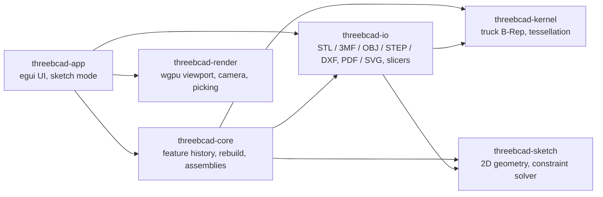
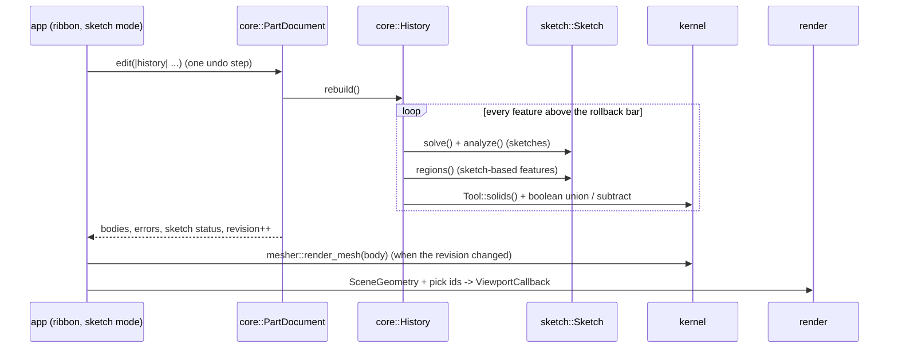

# 3BCAD architecture

3BCAD is a Cargo workspace of six crates. Each one owns one of the systems that make a parametric
CAD program: geometry kernel, 2D solver, feature tree, graphics, and files and print tooling.

Dependency rules: `core` never depends on `render` or `app`; `kernel` never depends on `sketch`
(it takes its own `ProfileRegion` type, and `core` converts sketch regions into it). `core` uses `io` only
for the drawing page type (`io::drawing::Page`) it lays sheets out into; `io` never depends on `core`.

## Data flow of a rebuild

1. **Sketch** (`crates/3bcad-sketch`). Points live in one parameter vector. Every relation and
   dimension is a `Constraint` whose residuals are written once over the `Scalar` trait: evaluated
   with `f64` they give values, with the `Dual` number type they give exact derivatives. The solver
   (`solver.rs`) splits the sketch into independent components and runs Levenberg-Marquardt on each,
   using dense Cholesky for small components and preconditioned conjugate gradients for big ones.
   `analyze()` gets degrees of freedom and conflicts from the Jacobian's null space, which drives
   the blue / black / red colours. `regions()` finds closed loops (with holes) for features.
2. **History** (`crates/3bcad-core`). Features sit in a `petgraph` DAG (edge = "is built from",
   recomputed from what each `FeatureKind` references) with a rollback bar, suppression
   and reordering that keeps parents above children. `rebuild.rs` evaluates everything above the bar and
   records per-feature errors and warnings instead of failing the whole part. A cache keeps the state after
   each feature, so a rebuild starts at the first feature that changed (Ctrl+Q clears it).
3. **Kernel** (`crates/3bcad-kernel`). Every solid feature becomes a `Tool`: a profile swept along its
   plane (`Prism`, optionally drafted) or turned about an axis (`Revolution`, built as exact NURBS because
   truck-shapeops cannot intersect truck's own revolved surfaces). `boolean.rs` adds, subtracts or
   intersects tools with bodies, isolating truck panics, checking volumes and retrying coplanar cases with
   the tool grown by 1 µm. `edge_ops.rs` turns an edge into a fillet/chamfer tool, `offset.rs` offsets
   profiles (draft, thin walls, Shell), `topology.rs` lists faces/edges/vertices in the same order as the
   render mesh, and `mass.rs` integrates mass properties.
4. **Naming** (`crates/3bcad-core/src/naming.rs`). Faces a tool creates are tagged (feature, pattern
   instance, region, tool face); after each boolean a result face inherits the tag of the source face it
   lies on. Edges are named by their two faces' tags, vertices by theirs, so `FaceRef` / `EdgeRef` /
   `VertexRef` keep pointing at the right geometry when dimensions change. Each body also records its
   `csg` steps, which patterns, mirrors, Shell and Draft replay or transform.
5. **Render** (`crates/3bcad-render`). The app builds a `SceneGeometry` whose vertices carry a pick
   id. Hover and selection are a per-id state buffer on the GPU, so highlighting never re-uploads
   meshes. `pick()` ray-casts faces/planes and measures edges/vertices in screen space.
6. **App** (`crates/3bcad-app`). `eframe` window; `ui/sketch_mode.rs` holds the interactive sketcher
   (tools, inferencing, Smart Dimension, drag), working on a copy of the sketch that is written back
   as one undo step when you exit the sketch. `ui/ribbon.rs` creates features from the current
   selection, `ui/properties.rs` edits them, `ui/evaluate.rs` holds the rebuild errors window, Measure and
   Mass Properties, and `ui/print.rs` the 3D Print tab.

## Files

- **Part files** (`crates/3bcad-core/src/document.rs`). A `.3bcad` file is pretty-printed JSON of the
  feature history (the `History` graph with its node ids), units and material, tagged with a format
  name and `FORMAT_VERSION`. Geometry is never saved: opening a file rebuilds it. Changing a saved type
  (`FeatureKind`, `Sketch`, ...) changes the format: bump `FORMAT_VERSION` and teach `migrate` to rewrite
  the old JSON, and keep the corpus round-trip test (`tests/parts.rs`) passing. Files from a newer version
  and damaged files (checked by `History::validate` and `Sketch::is_consistent`) are refused.
- **Imports** (`crates/3bcad-io`). Every reader takes untrusted bytes and returns an error, never a
  panic; `fuzz/` holds a cargo-fuzz target per reader. STEP solids become an `Imported` feature that
  stores the compressed truck solid; meshes become `ImportedMesh` reference bodies; DXF becomes a sketch.
- **App** (`crates/3bcad-app/src/files.rs`). The File menu, recent files and autosave settings
  (`settings.txt` in the user's config folder) and crash recovery (one autosave file per process in
  `recovery/`, removed after a save or a normal exit).

## 3D printing

- **Checks** (`crates/3bcad-kernel/src/print.rs`) work on plain triangles: `overhangs` flags triangles
  facing down past the limit (skipping those on the bed), `wall_thickness` casts a ray from each triangle
  straight into the part through a small BVH, and `lay_flat` is the rotation that puts a face on the bed.
  The app runs them on the display mesh and tints the flagged triangles (a per-vertex `tint` in
  `MeshVertex`), so the colours follow every rebuild.
- **Layout** (`crates/3bcad-app/src/print.rs`). The part's print orientation is the outward normal of the
  face it rests on (`PartDocument::print_down`, saved in the file). While the 3D Print tab is open the
  scene shows the part turned onto that face and centred on the bed; STL and 3MF exports use the same
  placement, centred on the plate. STEP keeps model coordinates.
- **Fit** (`crates/3bcad-kernel/src/fit.rs`) moves flat and cylindrical faces directly in the B-Rep:
  flat faces slide, cylinders change radius, and each corner is re-solved as the smallest move that keeps
  it on all its faces. Booleans cannot do this: a band cut along a face runs its walls along the part's
  own faces, and truck gets coaxial cylinders wrong.
- **Preferences** for printing (slicer and its location, printer and bed, overhang limit, nozzle, minimum
  wall, export tolerances) live in `files::Settings`.

## Assemblies

- **Documents** (`crates/3bcad-core/src/assembly.rs`). An `AssemblyDocument` holds components (a file, a
  pose and whether it is fixed, under an id that stays put when others are removed), mates and explode
  steps. The `.3bcasm` file saves component files relative to itself; the parts are read from their own
  files and read again when their modification time changes (`refresh`), so the assembly always shows
  the saved part. Sub-assemblies are read the same way and placed as one rigid component; `leaves`
  flattens everything into placed parts. A mate holds a `FaceRef` of a part, so it survives the part's
  rebuilds like a fillet does.
- **Solver** (`crates/3bcad-kernel/src/mate.rs`). Each free component has six unknowns (a translation
  and a rotation vector about its origin) and each mate a few residuals, directions weighed by the size
  of the assembly. Components joined by mates solve together with Levenberg–Marquardt, other groups on
  their own. When a group cannot hold all its mates, the mates are added back one at a time and each one
  that breaks the ones before it is reported as over-defined and left out. A mouse drag is a weak extra
  residual pulling the component towards the mouse, followed by a solve without it, so the mates always
  win.
- **Interference** (`crates/3bcad-kernel/src/interference.rs`) works on triangle meshes, since truck's
  booleans fail on the coincident faces mated parts have. The shared volume is bounded by the pieces of
  each surface inside the other part; triangles are split across their longest edge where the inside
  test changes, and each piece is tested just inside and just outside its surface, so faces that only
  touch, or lie on each other, are counted right.
- **Export** (`crates/3bcad-io/src/step.rs`, `crates/3bcad-app/src/assembly.rs`). STEP writes each part
  once as its own product and every component as a `NEXT_ASSEMBLY_USAGE_OCCURRENCE` with an
  `ITEM_DEFINED_TRANSFORMATION`; CI reads it with OpenCASCADE and checks the components land where they
  were. 3MF writes one object per part, laid flat on its print face and set out in rows on the bed.

## Drawings

- **Documents** (`crates/3bcad-core/src/drawing.rs`). A `DrawingDocument` holds sheets (size, scale,
  first or third angle), each with views, dimensions and notes, plus one title block for all sheets. The
  `.3bcdrw` file saves the part's file relative to itself and reads the part again when its modification
  time changes (`refresh`), like an assembly. A view is a model view (a fixed orientation), or is made
  from a parent on the same sheet: projected (the parent turned towards a side, by the projection angle),
  section (projected, with a cutting plane) or detail (the parent's lines inside a circle, scaled). Views
  are kept in order, parents first, so one pass draws them all; a child stores only the coordinate along
  which it may move, the other is the parent's, so it stays lined up.
- **Hidden lines** (`crates/3bcad-kernel/src/hlr.rs`) work on `Topology`: B-Rep edges (smooth seams only
  where they are the outline), silhouettes traced as the zero line of surface normal · view direction
  (exact normals on cylinders), and the face triangles, binned on a grid, as occluders. Each line is cut
  every 1/300 of the part's size and each piece is seen or hidden by whether a triangle lies in front of
  its middle. A section keeps the material behind the plane, and the triangles the plane crosses give the
  cut outline, which also hides what lies behind the cut faces (an even-odd test). Projections are cached
  by the part's read and the view's frame, so moving a view never projects again.
- **Annotations** hold `Anchor`s: a `VertexRef` or circular `EdgeRef` of the part, a sketch point or
  circle, or an extrusion's ends, so dimensions follow the part's changes; their values are measured off
  the projected geometry. Section hatching is chosen from the material name (ANSI31/32/33/37).
- **Pages** (`DrawingDocument::page`) lay a sheet out as marks (lines, fills, text) in paper millimetres on
  layers. The app paints them with egui; `crates/3bcad-io/src/drawing.rs` writes them as PDF (Helvetica,
  a millimetre-to-point matrix, one page per sheet), SVG and R12 DXF with a layer and line type per kind of
  line.

## Adding a new feature type (example: Rib)

1. **Kernel**: if no existing `Tool` shape fits, add one (or a helper like `offset::thicken_chain`) with
   a test that checks a physical property (volume) and watertightness (see `mesher.rs` tests).
2. **Core**: add a variant to `FeatureKind` in `feature.rs` (with its `prefix` and every reference
   in `references()`), and a match arm in `Eval::run` (`rebuild.rs`) that builds tools and
   applies them with `Eval::apply`. Add a `document.rs` test that builds it, changes a dimension and
   checks the volume; add a part to `tests/parts/corpus.rs` if it is a new kind of geometry.
3. **App**: a ribbon button in `ui/ribbon.rs` (Features tab) that fills the feature from the selection,
   an icon in `ui/icons.rs` (`of_feature`), and its parameters in `ui/properties.rs` (the `Ed` helper
   turns drags into one undo step).
4. **Docs**: add a line to `CHANGELOG.md` under `[Unreleased]`.

## Adding a sketch relation

1. Add a variant to `Constraint` in `crates/3bcad-sketch/src/constraint.rs` and fill in `name`,
   `points` / `entities`, `remap`, `is_valid`, `locals` (parameter order) and `eval` (residuals).
2. Add it to `every_relation_has_exact_derivatives` in `lib.rs`; that test checks the
   auto-differentiated Jacobian against finite differences.
3. If it can be added from the UI, offer it in `Sketch::relation_candidates` (`tools.rs`).
