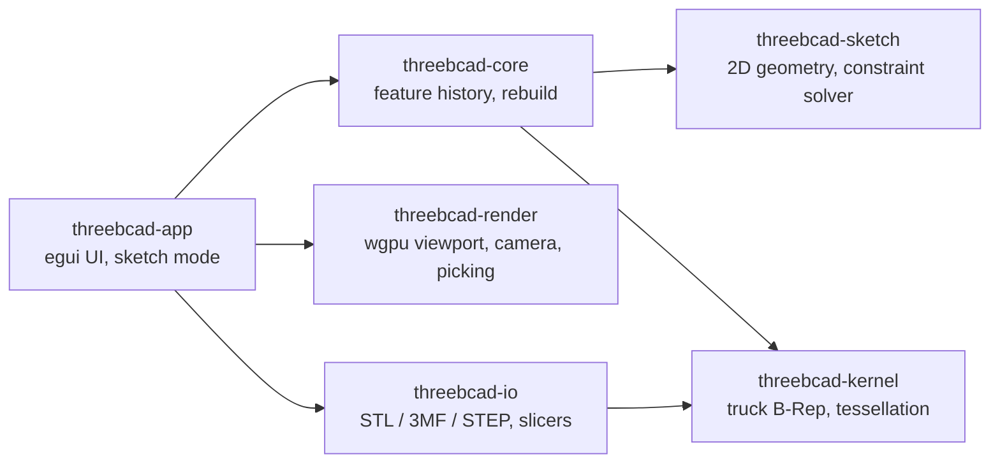
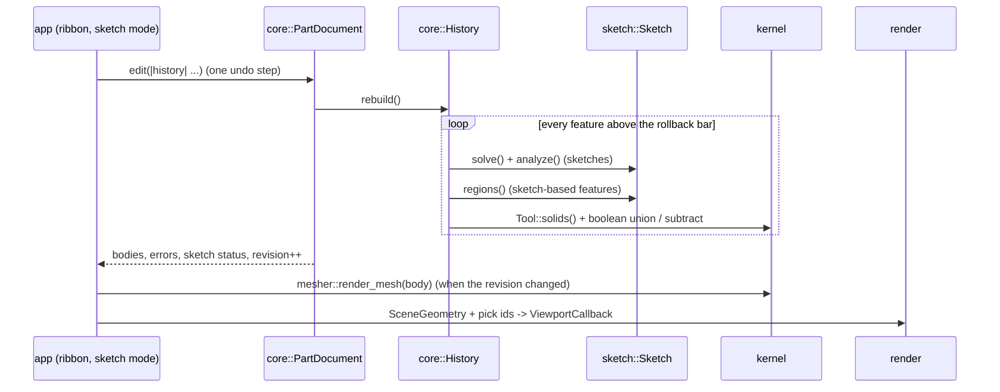

# 3BCAD architecture

3BCAD is a Cargo workspace of six crates. Each one owns one of the systems that make a parametric
CAD program, mirroring the split SolidWorks uses (kernel, 2D solver, feature tree, graphics, print tooling).

Dependency rules: `core` never depends on `render` or `app`; `kernel` never depends on `sketch`
(it takes its own `ProfileRegion` type, and `core` converts sketch regions into it).

## Data flow of a rebuild

1. **Sketch** (`crates/3bcad-sketch`). Points live in one parameter vector. Every relation and
   dimension is a `Constraint` whose residuals are written once over the `Scalar` trait: evaluated
   with `f64` they give values, with the `Dual` number type they give exact derivatives. The solver
   (`solver.rs`) splits the sketch into independent components and runs Levenberg-Marquardt on each,
   using dense Cholesky for small components and preconditioned conjugate gradients for big ones.
   `analyze()` gets degrees of freedom and conflicts from the Jacobian's null space, which drives
   the blue / black / red colours. `regions()` finds closed loops (with holes) for features.
2. **History** (`crates/3bcad-core`). Features sit in a `petgraph` DAG (edge = "is built from",
   recomputed from what each `FeatureKind` references) with a SolidWorks-style rollback bar, suppression
   and reordering that keeps parents above children. `rebuild.rs` evaluates everything above the bar and
   records per-feature errors and warnings instead of failing the whole part. A cache keeps the state after
   each feature, so a rebuild starts at the first feature that changed (Ctrl+Q clears it).
3. **Kernel** (`crates/3bcad-kernel`). Every solid feature becomes a `Tool`: a profile swept along its
   plane (`Prism`, optionally drafted) or turned about an axis (`Revolution`, built as exact NURBS because
   truck-shapeops cannot intersect truck's own revolved surfaces). `boolean.rs` adds, subtracts or
   intersects tools with bodies, isolating truck panics, checking volumes and retrying coplanar cases with
   the tool grown by 1 µm. `edge_ops.rs` turns an edge into a fillet/chamfer tool, `offset.rs` offsets
   profiles (draft, thin walls, Shell), `topology.rs` lists faces/edges/vertices in the same order as the
   render mesh, and `mass.rs` integrates mass properties.
4. **Naming** (`crates/3bcad-core/src/naming.rs`). Faces a tool creates are tagged (feature, pattern
   instance, region, tool face); after each boolean a result face inherits the tag of the source face it
   lies on. Edges are named by their two faces' tags, vertices by theirs, so `FaceRef` / `EdgeRef` /
   `VertexRef` keep pointing at the right geometry when dimensions change. Each body also records its
   `csg` steps, which patterns, mirrors, Shell and Draft replay or transform.
5. **Render** (`crates/3bcad-render`). The app builds a `SceneGeometry` whose vertices carry a pick
   id. Hover and selection are a per-id state buffer on the GPU, so highlighting never re-uploads
   meshes. `pick()` ray-casts faces/planes and measures edges/vertices in screen space.
6. **App** (`crates/3bcad-app`). `eframe` window; `ui/sketch_mode.rs` holds the interactive sketcher
   (tools, inferencing, Smart Dimension, drag), working on a copy of the sketch that is written back
   as one undo step when you exit the sketch. `ui/ribbon.rs` creates features from the current
   selection, `ui/properties.rs` edits them, `ui/evaluate.rs` holds What's Wrong, Measure and Mass
   Properties.

## Adding a new feature type (example: Rib)

1. **Kernel**: if no existing `Tool` shape fits, add one (or a helper like `offset::thicken_chain`) with
   a test that checks a physical property (volume) and watertightness (see `mesher.rs` tests).
2. **Core**: add a variant to `FeatureKind` in `feature.rs` (with its `prefix`, `icon` and every
   reference in `references()`), and a match arm in `Eval::run` (`rebuild.rs`) that builds tools and
   applies them with `Eval::apply`. Add a `document.rs` test that builds it, changes a dimension and
   checks the volume; add a part to `tests/parts/corpus.rs` if it is a new kind of geometry.
3. **App**: a ribbon button in `ui/ribbon.rs` (Features tab) that fills the feature from the selection,
   and its parameters in `ui/properties.rs` (the `Ed` helper turns drags into one undo step).
4. **Docs**: add a line to `CHANGELOG.md` under `[Unreleased]`.

## Adding a sketch relation

1. Add a variant to `Constraint` in `crates/3bcad-sketch/src/constraint.rs` and fill in `name`,
   `points` / `entities`, `remap`, `is_valid`, `locals` (parameter order) and `eval` (residuals).
2. Add it to `every_relation_has_exact_derivatives` in `lib.rs`; that test checks the
   auto-differentiated Jacobian against finite differences.
3. If it can be added from the UI, offer it in `Sketch::relation_candidates` (`tools.rs`).
